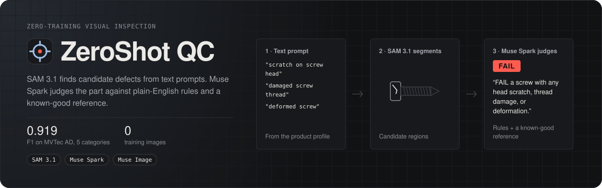
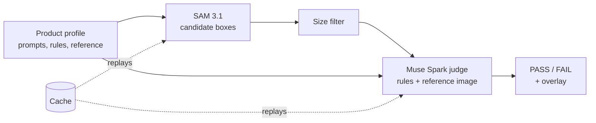
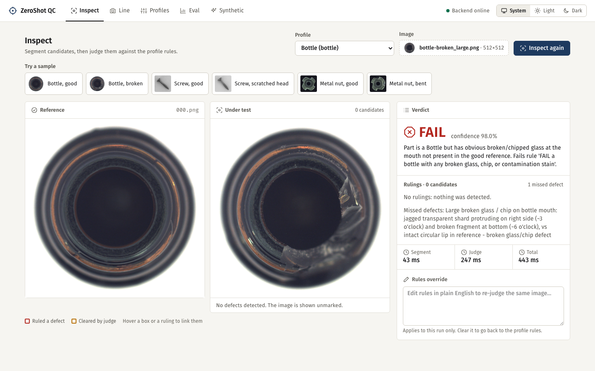
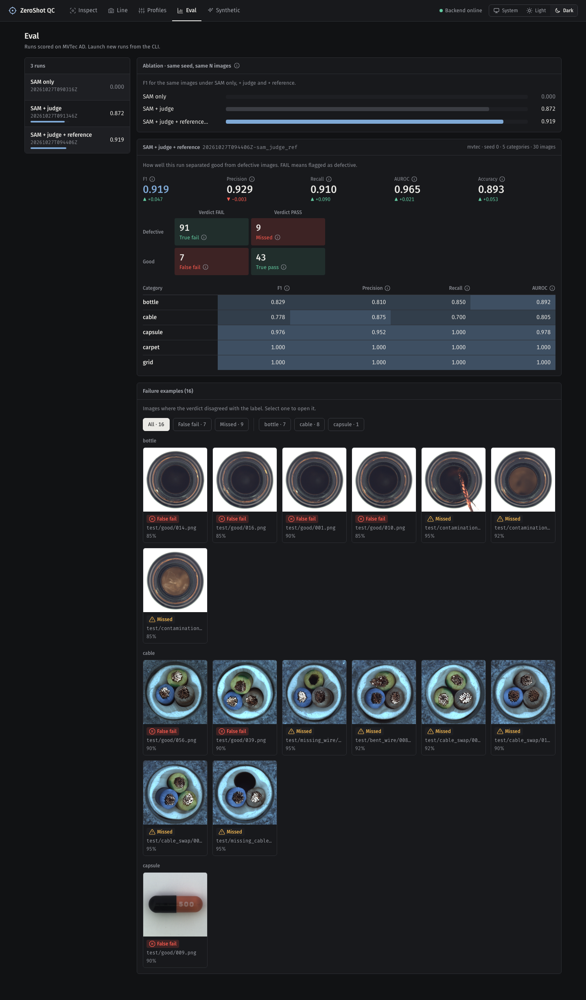

<p align="center">
  <picture>
    <source media="(max-width: 600px)" srcset="docs/assets/banner-narrow.svg">
    
  </picture>
</p>

<p align="center">
  <a href="#quickstart"></a>
  <a href="#which-meta-models-do-what"></a>
  <a href="backend/demo/LICENSE-MVTEC.md"></a>
</p>

<p align="center">
  <a href="https://youtu.be/rWs2xwe_d7o"></a>
  <br>
  <a href="https://youtu.be/rWs2xwe_d7o">Watch the 3-minute demo on YouTube</a>
</p>

- **What it does.** Visual inspection with zero training: SAM 3.1 proposes candidate defects from text prompts, then Muse Spark judges the part against plain-English rules and a known-good reference image. No labelled defect images, no model training.
- **How well.** On real MVTec AD (5 categories x 30 images), F1 is 0.919 with a reference image, 0.872 without one, and 0.000 for SAM alone. Details and caveats are in [Results](#results).
- **Where your data goes.** The bundled demo replays cached verdicts offline and sends nothing anywhere. Live mode (you add `META_API_KEY`) sends your images and rules to the Meta Model API endpoint set in `META_API_BASE_URL`.

## Quickstart

You need [Docker](https://docs.docker.com/get-docker/) with the daemon running. No API key and no `.env` are required.

```sh
docker compose up --build
```

Open http://localhost:8080. Every page is already populated from a bundled demo set.

What to try:

- **Inspect**: click a "Try a sample" thumbnail. It picks the profile and returns a real SAM + Muse Spark verdict, replayed from cache. Edit the rules box to re-judge; with no key, edits and your own uploads return a placeholder verdict with a "Demo result" banner.
- **Eval**: three evaluation runs with failure thumbnails.
- **Synthetic**: generated bottle defect images with masks.
- **Profiles**: product profiles with their reference images.

To run real inspections on your own images, add a key:

```sh
cp .env.example .env
# set META_API_KEY in .env
docker compose up --build
```

## Results

Real MVTec AD, real adapters, F1 per category (the demo's Eval page shows the same runs):

| Mode | bottle | cable | capsule | carpet | grid | Overall |
|---|---|---|---|---|---|---|
| SAM only | 0.000 | 0.000 | 0.000 | 0.000 | 0.000 | 0.000 |
| SAM + judge | 0.842 | 0.625 | 0.842 | 1.000 | 1.000 | 0.872 |
| SAM + judge + reference | 0.829 | 0.778 | 0.976 | 1.000 | 1.000 | **0.919** |

Read these with the caveats in mind:

- SAM proposes no defect-level masks on these categories, so IoU is 0.000 throughout. It returns object-level boxes or nothing.
- The judge carries the system, through its missed-defect path. The reference image adds recall (0.820 to 0.910); the segmenter adds nothing on these categories.
- 30 images per category is small, and this is a single seed.
- A real probe of a scratched screw head was a silent PASS on a defective part (confidence 0.85).
- The banner's screw is an example. Screw is not in this eval yet.

<details>
<summary>How this is measured</summary>

Seed 0; per category, 10 good and 20 defective images; categories bottle, cable, capsule, carpet and grid (150 images per mode). Every mode used the same rules string:

> FAIL any visible scratch, stain, or surface damage; PASS otherwise.

Records are in `backend/demo/runs/*/summary.json`; notes and failure patterns are in [docs/EVAL_NOTES.md](docs/EVAL_NOTES.md).

</details>

## Which Meta models do what

| Model | Job | Called from |
|---|---|---|
| SAM 3.1 | Segments candidate defect regions from the profile's text prompts | [`backend/app/adapters/sam.py`](backend/app/adapters/sam.py) |
| Muse Spark | Judges the part against the rules and the reference image; also drafts a profile from an SOP | [`backend/app/adapters/muse_spark.py`](backend/app/adapters/muse_spark.py) |
| Muse Image | Generates synthetic defect images for test data | [`backend/app/adapters/muse_image.py`](backend/app/adapters/muse_image.py) |

## How it works



The cache stores model responses so the demo replays real verdicts without a key.

## Screens

Inspect, after clicking "Bottle, broken": the judge fails the part through a missed defect even though SAM proposed nothing.



Eval: the three runs, F1 ablation, confusion matrix and failure examples. Try the "False fail" and "Missed" filters.



## Use it from code

With the stack running, POST an image and a profile to the inspect endpoint (`backend/app/routers/inspect.py`). A cached sample replays its real verdict:

```sh
curl -s -X POST http://localhost:8080/api/inspect \
  -F image=@backend/demo/samples/bottle-broken_large.png \
  -F profile_id=bottle
```

```json
{
  "profile_id": "bottle",
  "detections": [],
  "verdict": {
    "verdict": "FAIL",
    "confidence": 0.98,
    "rulings": [],
    "missed_defects": ["Large broken glass / chip on bottle mouth: ..."],
    "part_matches": true,
    "summary": "Part is a Bottle but has obvious broken/chipped glass at the mouth ..."
  },
  "demo": false
}
```

(Trimmed: the real response also carries `id`, `overlay_url` and `timings_ms`.) `cli.py inspect` exists too, but it needs the backend's Python dependencies on the host and does not replay the demo cache, so it is not part of the keyless quickstart.

## Stop and reset

```sh
docker compose down      # stop, keep data
docker compose down -v   # stop and wipe data; the bundle reseeds on the next start
```

## Data & licensing

The bundled demo set includes a downscaled subset of the [MVTec AD](https://www.mvtec.com/company/research/datasets/mvtec-ad) dataset, (c) MVTec Software GmbH, redistributed under [CC BY-NC-SA 4.0](https://creativecommons.org/licenses/by-nc-sa/4.0/) with attribution (`backend/demo/LICENSE-MVTEC.md`). Non-commercial use only; derivatives keep the same licence. Never commit API keys.

No code licence has been chosen yet.

## Development

Manual run and container probes: [docs/DEVELOPMENT.md](docs/DEVELOPMENT.md).
