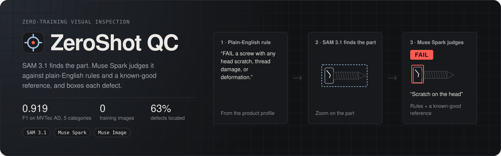
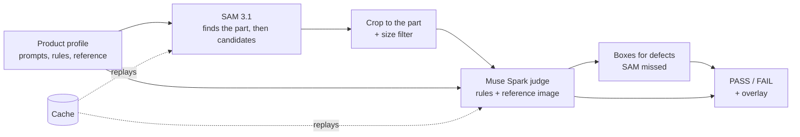
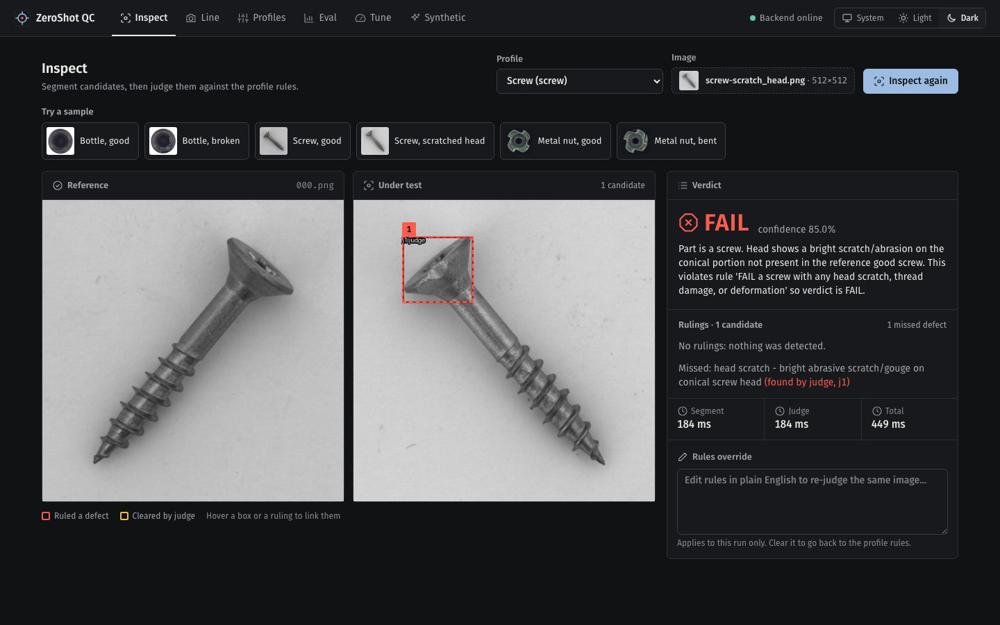
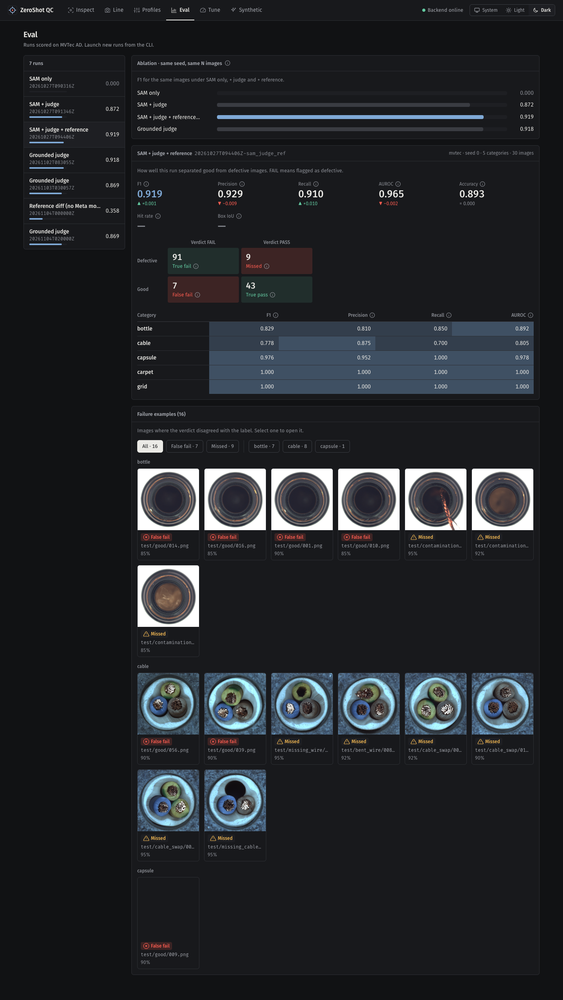
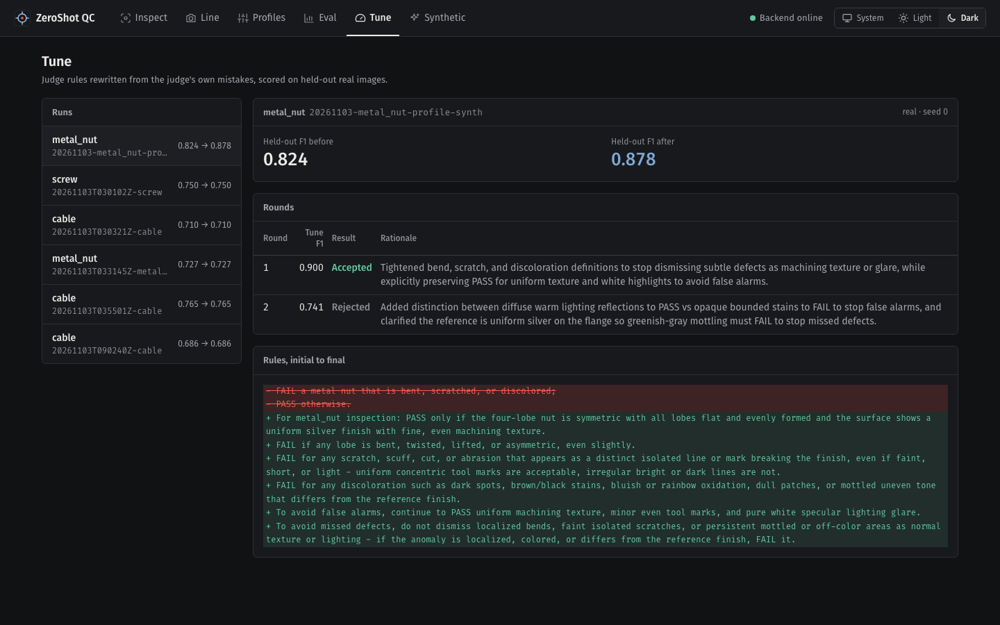

<p align="center">
  <picture>
    <source media="(max-width: 600px)" srcset="docs/assets/banner-narrow.svg">
    
  </picture>
</p>

<p align="center">
  <a href="#quickstart"></a>
  <a href="#which-meta-models-do-what"></a>
  <a href="backend/demo/LICENSE-MVTEC.md"></a>
</p>

<p align="center">
  <a href="https://youtu.be/IlT8yUzFjS8"></a>
  <br>
  <a href="https://youtu.be/IlT8yUzFjS8">Watch the 3-minute demo on YouTube</a>
</p>

- **What it does.** Visual inspection with zero training: SAM 3.1 finds the part, then Muse Spark judges it against plain-English rules and a known-good reference image and boxes each defect. No labelled defect images, no model training.
- **How well.** On real MVTec AD (5 categories x 30 images), F1 is 0.918 in grounded mode, which also puts a box on 63% of real defects. It is 0.919 with a reference image but no boxes, 0.872 without a reference, and 0.000 for SAM alone. Across 7 categories (adding screw and metal nut) grounded F1 is 0.869. Rule tuning helped in 1 of 6 runs: when the synthetic defects matched the real ones, metal nut rose from 0.824 to 0.878. Details and caveats are in [Results](#results).
- **Where your data goes.** The bundled demo replays cached verdicts offline and sends nothing anywhere. Live mode (you add `META_API_KEY`) sends your images and rules to the Meta Model API endpoint set in `META_API_BASE_URL`.

## Quickstart

You need [Docker](https://docs.docker.com/get-docker/) with the daemon running. No API key and no `.env` are required.

```sh
docker compose up --build
```

Open http://localhost:8080. Every page is already populated from a bundled demo set.

What to try:

- **Inspect**: click a "Try a sample" thumbnail. It picks the profile and returns a real SAM + Muse Spark verdict, replayed from cache. Edit the rules box to re-judge; with no key, edits and your own uploads return a placeholder verdict with a "Demo result" banner.
- **Eval**: three evaluation runs with failure thumbnails.
- **Synthetic**: generated bottle defect images with masks.
- **Profiles**: product profiles with their reference images.

To run real inspections on your own images, add a key:

```sh
cp .env.example .env
# set META_API_KEY in .env
docker compose up --build
```

## Results

Real MVTec AD, real adapters, F1 per category (the demo's Eval page shows the same runs):

| Mode | bottle | cable | capsule | carpet | grid | Overall |
|---|---|---|---|---|---|---|
| SAM only | 0.000 | 0.000 | 0.000 | 0.000 | 0.000 | 0.000 |
| SAM + judge | 0.842 | 0.625 | 0.842 | 1.000 | 1.000 | 0.872 |
| SAM + judge + reference | 0.829 | 0.778 | 0.976 | 1.000 | 1.000 | **0.919** |
| Grounded (part crop + judge boxes) | 0.850 | 0.743 | 0.976 | 1.000 | 1.000 | **0.918** |

Grounded mode also locates defects. Hit rate is the share of defects where a box covers at least half of the true defect:

| | bottle | cable | capsule | carpet | grid | Overall |
|---|---|---|---|---|---|---|
| Hit rate | 0.400 | 0.550 | 0.600 | 0.900 | 0.700 | **0.630** |
| Box IoU | 0.334 | 0.340 | 0.360 | 0.578 | 0.431 | 0.409 |
| Pixel IoU | 0.303 | 0.205 | 0.317 | 0.407 | 0.250 | 0.296 |

The current pipeline (judge at temperature 0, part-sized SAM candidates dropped) on 7 categories, same shared rules string:

| | bottle | cable | capsule | carpet | grid | metal nut | screw | Overall |
|---|---|---|---|---|---|---|---|---|
| F1 | 0.872 | 0.686 | 0.976 | 1.000 | 1.000 | 0.727 | 0.750 | **0.869** |
| Hit rate | 0.450 | 0.600 | 0.550 | 0.950 | 0.700 | 0.600 | 0.350 | 0.600 |

On the first five categories this is F1 0.913 against 0.918: the same within noise (7 of 150 verdicts changed, in both directions). With each profile's own rules instead of the shared string, metal nut rises to 0.824 (bent nuts missed: 6 of 8 down to 2) and screw stays at 0.750, both at precision 1.000.

Rule tuning, scored on held-out real images that tuning never saw:

| Category | Seed | Start rules | Synthetic defects | F1 before | F1 after |
|---|---|---|---|---|---|
| cable | 0 | shared | generic | 0.686 | 0.686 |
| cable | 1 | shared | generic | 0.765 | 0.765 |
| cable | 2 | shared | generic | 0.710 | 0.710 |
| screw | 0 | shared | generic | 0.750 | 0.750 |
| metal nut | 0 | shared | generic | 0.727 | 0.727 |
| metal nut | 0 | profile | bent, flipped, scratch, discolored | 0.824 | **0.878** |

"Generic" synthetic defects are scratch, crack, contamination and chip. The judge already catches those, so the tune set shows it few mistakes to learn from. Naming the defects the part really has (`--synth-defects`) gave the clearest gain: metal nut recall went from 0.70 to 0.90, with precision falling from 1.000 to 0.857.

Read these with the caveats in mind:

- SAM proposes no defect-level masks on these categories. In the older modes IoU is 0.000 throughout. Grounded mode uses SAM to find the part, crops to it, and turns the judge's boxes into detections. All of its localization comes from those boxes.
- The judge carries the system, through its missed-defect path. The reference image adds recall (0.820 to 0.910).
- Tuning sees only good images and Muse Image synthetic defects, no real defect labels. Its held-out set is the eval's 30-image sample for that seed, which tuning never reads. One gain in six runs is thin evidence.
- 30 images per category is small, and this is a single seed.
- In the demo samples the scratched screw head now FAILs. The bent metal nut still PASSes: bent nuts are the hardest case here, and this one also PASSes under the tuned rules.

<details>
<summary>How this is measured</summary>

Seed 0; per category, 10 good and 20 defective images; categories bottle, cable, capsule, carpet and grid (150 images per mode). Every mode used the same rules string:

> FAIL any visible scratch, stain, or surface damage; PASS otherwise.

Records are in `backend/demo/runs/*/summary.json`; notes and failure patterns are in [docs/EVAL_NOTES.md](docs/EVAL_NOTES.md).

</details>

## Which Meta models do what

| Model | Job | Called from |
|---|---|---|
| SAM 3.1 | Finds the part (so the app can zoom in on it) and segments candidate defect regions from the profile's text prompts | [`backend/app/adapters/sam.py`](backend/app/adapters/sam.py) |
| Muse Spark | Judges the part against the rules and the reference image and boxes the defects it finds; rewrites the rules in tuning; also drafts a profile from an SOP | [`backend/app/adapters/muse_spark.py`](backend/app/adapters/muse_spark.py) |
| Muse Image | Generates synthetic defect images for test data and for the tune set | [`backend/app/adapters/muse_image.py`](backend/app/adapters/muse_image.py) |

## How it works



The cache stores model responses so the demo replays real verdicts without a key.

The Tune page replays offline rule tuning: the judge's rules are rewritten from its mistakes on good images plus synthetic defects, kept only when F1 improves, and scored on held-out real images (`python -m app.tune.run`).

## Screens

Inspect, after clicking "Screw, scratched head": the judge fails the part and boxes the scratch on the head.



Eval: the five runs, F1 ablation, confusion matrix and failure examples. Try the "False fail" and "Missed" filters.



Tune: the rules before and after tuning on metal nut, with the held-out F1 (0.824 to 0.878).



## Use it from code

With the stack running, POST an image and a profile to the inspect endpoint (`backend/app/routers/inspect.py`). A cached sample replays its real verdict:

```sh
curl -s -X POST http://localhost:8080/api/inspect \
  -F image=@backend/demo/samples/bottle-broken_large.png \
  -F profile_id=bottle
```

```json
{
  "profile_id": "bottle",
  "detections": [],
  "verdict": {
    "verdict": "FAIL",
    "confidence": 0.98,
    "rulings": [],
    "missed_defects": ["Large broken glass / chip on bottle mouth: ..."],
    "part_matches": true,
    "summary": "Part is a Bottle but has obvious broken/chipped glass at the mouth ..."
  },
  "demo": false
}
```

(Trimmed: the real response also carries `id`, `overlay_url` and `timings_ms`.) `cli.py inspect` exists too, but it needs the backend's Python dependencies on the host and does not replay the demo cache, so it is not part of the keyless quickstart.

## Stop and reset

```sh
docker compose down      # stop, keep data
docker compose down -v   # stop and wipe data; the bundle reseeds on the next start
```

## Data & licensing

The bundled demo set includes a downscaled subset of the [MVTec AD](https://www.mvtec.com/company/research/datasets/mvtec-ad) dataset, (c) MVTec Software GmbH, redistributed under [CC BY-NC-SA 4.0](https://creativecommons.org/licenses/by-nc-sa/4.0/) with attribution (`backend/demo/LICENSE-MVTEC.md`). Non-commercial use only; derivatives keep the same licence. Never commit API keys.

No code licence has been chosen yet.

## Development

Manual run and container probes: [docs/DEVELOPMENT.md](docs/DEVELOPMENT.md).
